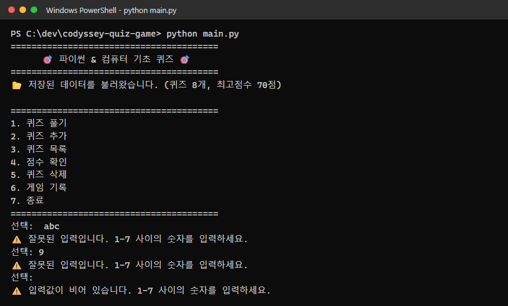
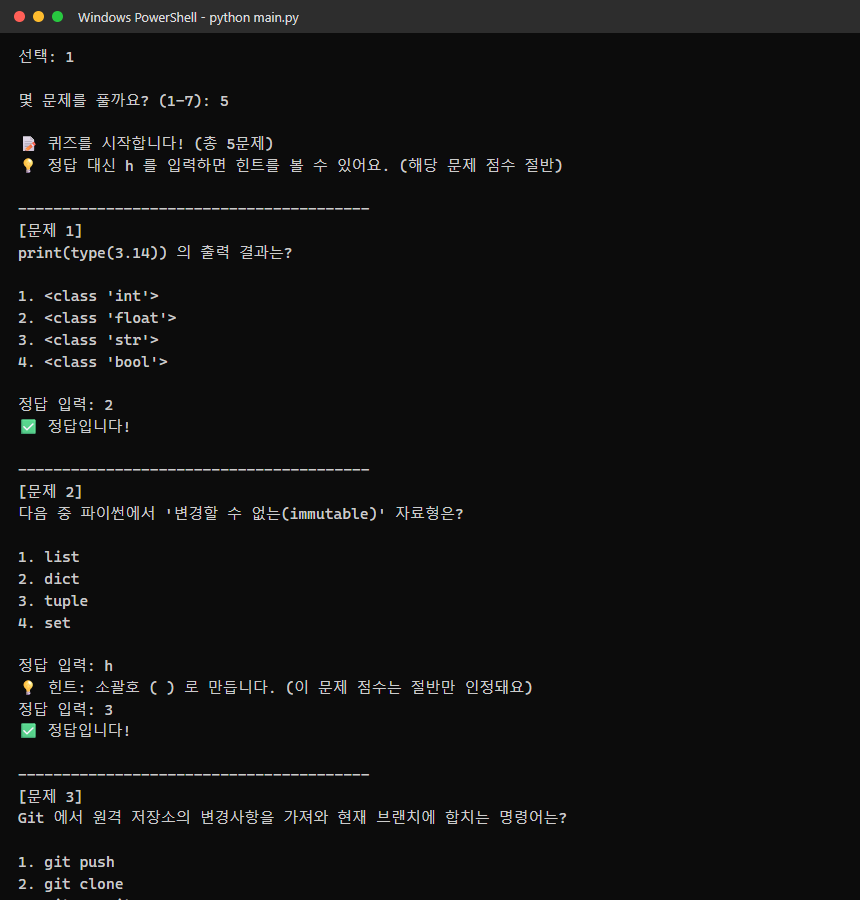
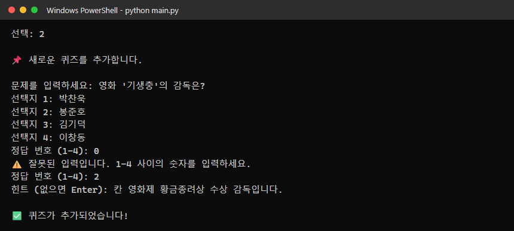
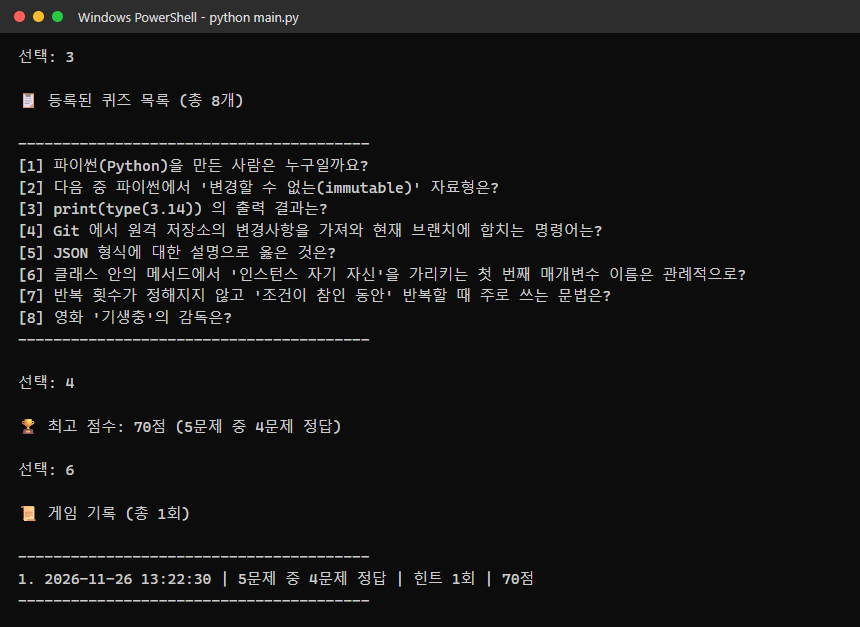

# 🎯 파이썬 & 컴퓨터 기초 퀴즈 게임

## 1. 프로젝트 개요

Python 표준 라이브러리만으로 만든 **콘솔 퀴즈 게임**입니다.
메뉴에서 번호를 선택해 퀴즈를 풀고, 새 퀴즈를 등록하고, 목록과 최고 점수를 확인할 수 있습니다.
추가한 퀴즈와 최고 점수, 게임 기록은 프로젝트 루트의 `state.json`(UTF-8)에 저장되어
프로그램을 종료했다가 다시 실행해도 그대로 유지됩니다.

- 개발 언어: Python 3.10 이상 (외부 라이브러리 없음)
- 버전 관리: Git / GitHub

## 2. 퀴즈 주제와 선정 이유

**주제: 파이썬 & 컴퓨터 기초 (Python 문법, 자료형, Git, JSON)**

이 미션에서 처음 배우는 파이썬 문법(자료형, 반복문, 클래스)과 Git 명령어, JSON 형식을
퀴즈로 만들면 프로그램을 만드는 동시에 배운 내용을 복습할 수 있다고 생각했습니다.
직접 문제와 오답 선택지를 만들면서 개념을 한 번 더 정확하게 정리하는 효과도 있습니다.

## 3. 실행 방법

```bash
# 1) 저장소 복제
git clone https://github.com/kwangsclub/codyssey-quiz-game.git
cd codyssey-quiz-game

# 2) 파이썬 버전 확인 (3.10 이상)
python --version

# 3) 실행
python main.py
```

## 4. 기능 목록

| 메뉴 | 기능 | 설명 |
| --- | --- | --- |
| 1 | 퀴즈 풀기 | 풀 문제 수를 고르면 **랜덤 순서**로 출제, 정답/오답 안내, 결과 점수(100점 만점) 표시, 최고 점수 갱신 |
| 2 | 퀴즈 추가 | 문제, 선택지 4개, 정답 번호(1-4), 힌트(선택)를 입력받아 등록 후 즉시 저장 |
| 3 | 퀴즈 목록 | 등록된 퀴즈 문제 목록 출력 (퀴즈가 없으면 안내) |
| 4 | 점수 확인 | 최고 점수 출력 (아직 풀지 않았으면 안내) |
| 5 | 퀴즈 삭제 | 번호로 퀴즈를 골라 확인(y/n) 후 삭제하고 파일에 반영 |
| 6 | 게임 기록 | 모든 게임의 날짜/시간, 문제 수, 정답 수, 힌트 사용 수, 점수 출력 |
| 7 | 종료 | 데이터를 저장하고 종료 |

**보너스 기능**: 랜덤 출제, 문제 수 선택, 힌트(문제 풀이 중 `h` 입력, 해당 문제 점수 절반), 퀴즈 삭제, 점수 기록 히스토리

**입력/예외 처리**

- 입력 앞뒤 공백 제거 후 처리 (예: ` 1 ` → `1`)
- 숫자가 아닌 입력(`abc`), 범위 밖 숫자(메뉴 `9`, 정답 `0`), 빈 입력(Enter)은 안내 메시지 후 다시 입력
- `Ctrl+C`(KeyboardInterrupt), 입력 스트림 종료(EOFError) 시 안내 메시지 출력 → 저장 → 안전 종료
- `state.json`이 없으면 기본 퀴즈로 시작, 손상되었으면 안내 후 기본 퀴즈 데이터로 복구

## 5. 파일 구조

```
codyssey-quiz-game/
├── main.py             # 실행 진입점 (QuizGame 생성 후 run)
├── quiz.py             # Quiz 클래스: 문제/선택지/정답/힌트, 출력·정답 확인·dict 변환
├── quiz_game.py        # QuizGame 클래스: 메뉴, 입력 처리, 풀기/추가/목록/점수/삭제/기록
├── storage.py          # StateStorage 클래스: state.json 저장/불러오기, 오류 처리
├── default_quizzes.py  # 기본 퀴즈 7개 (Quiz 인스턴스)
├── state.json          # 실행 시 자동 생성되는 데이터 파일 (.gitignore 처리)
├── docs/screenshots/   # 실행 화면 스크린샷
├── .gitignore
└── README.md
```

## 6. 데이터 파일 설명 (`state.json`)

- **경로**: 프로젝트 루트 `./state.json` (`main.py`와 같은 폴더)
- **역할**: 퀴즈 목록, 최고 점수, 게임 기록을 저장해 재실행 시에도 데이터를 유지
- **인코딩**: UTF-8 (`ensure_ascii=False`로 한글 그대로 저장)
- **생성 시점**: 첫 실행 시 자동 생성되며, 퀴즈 추가/삭제, 퀴즈 풀이 완료, 종료 시 저장
- **안전 저장**: 임시 파일(`state.json.tmp`)에 먼저 쓴 뒤 교체하여 저장 중 오류에도 기존 파일 보호

**스키마**

| 키 | 타입 | 설명 |
| --- | --- | --- |
| `quizzes` | list[dict] | 퀴즈 목록 |
| `quizzes[].question` | str | 문제 |
| `quizzes[].choices` | list[str] | 선택지 4개 |
| `quizzes[].answer` | int | 정답 번호 (1-4) |
| `quizzes[].hint` | str | 힌트 (없으면 빈 문자열) |
| `best_score` | int 또는 null | 최고 점수 (0-100, 아직 풀지 않았으면 null) |
| `history` | list[dict] | 게임 기록 (`played_at`, `total`, `correct`, `hints`, `score`) |

```json
{
    "quizzes": [
        {
            "question": "파이썬(Python)을 만든 사람은 누구일까요?",
            "choices": ["귀도 반 로섬", "리누스 토르발스", "비야네 스트롭스트룹", "제임스 고슬링"],
            "answer": 1,
            "hint": "네덜란드 출신 프로그래머입니다."
        }
    ],
    "best_score": 80,
    "history": [
        {"played_at": "2026-11-26 13:00:00", "total": 5, "correct": 4, "hints": 0, "score": 80}
    ]
}
```

## 7. 실행 화면

| 메뉴 | 퀴즈 풀기 |
| --- | --- |
|  |  |

| 퀴즈 추가 | 목록 / 점수 확인 |
| --- | --- |
|  |  |

## 8. Git 사용 기록

`init`, `add`, `commit`, `push`, `checkout`(브랜치 생성/전환), `merge`, `clone`, `pull`을 사용했습니다.
퀴즈 풀기 기능은 `feature/play-quiz` 브랜치에서 개발한 뒤 `main`에 병합했습니다.
